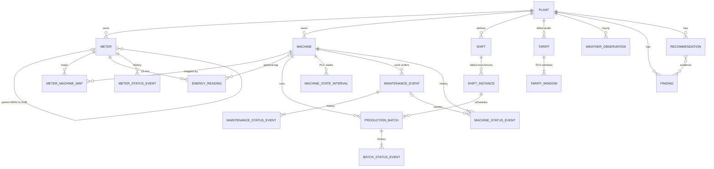

# Entity relationships

| Relationship | Cardinality | Notes |
|---|---|---|
| Plant → Meter / Machine / Shift / Tariff / Weather | 1:N | mandatory parent |
| Meter → Meter (parent) | 1:N, optional | MAIN has no parent; a SUB's parent must be the MAIN of the same plant |
| Meter ↔ Machine | **N:M** via `meter_machine_map` | `effective_from` / `effective_to`; the utilities meter maps 2 machines; the machine swap adds a new row |
| Meter → EnergyReading | 1:N | natural key `reading_id` must be unique after de-duplication |
| Machine → EnergyReading | 1:N, optional | only MACHINE-scope meters carry a tag |
| Shift → ShiftInstance → ProductionBatch | 1:N, 1:N | a batch must lie inside a WORKING instance of its own plant |
| Tariff → TariffWindow | 1:N | full-week coverage, no overlaps |
| Batch / work order / Machine / Meter → status events | 1:N | append-only; the parent's `status` = last event |
| Recommendation ↔ Finding | N:M (`evidence_ids` list) | analytics outputs |

## Lifecycle states
| Entity | Transitions |
|---|---|
| ProductionBatch | PLANNED → RELEASED → RUNNING → COMPLETED or SCRAPPED; PLANNED or RELEASED → CANCELLED |
| MaintenanceEvent | OPEN → IN_PROGRESS → CLOSED |
| Machine | INSTALLED → ACTIVE ↔ UNDER_MAINTENANCE; ACTIVE → DECOMMISSIONED |
| Meter | ACTIVE ↔ COMM_LOSS (gaps ≥ 4 h); ACTIVE → RETIRED |
| Recommendation | PROPOSED → ACCEPTED or REJECTED; ACCEPTED → IMPLEMENTED → VERIFIED |
